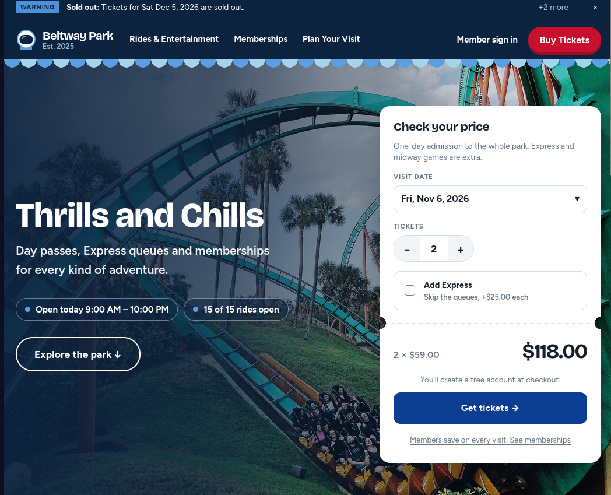
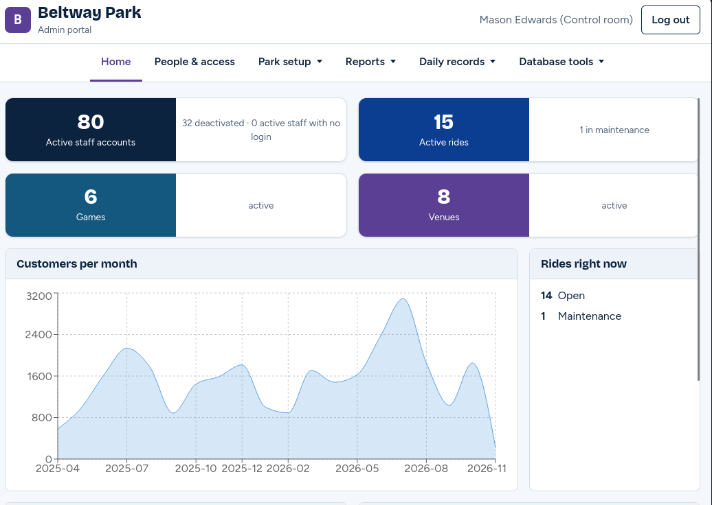
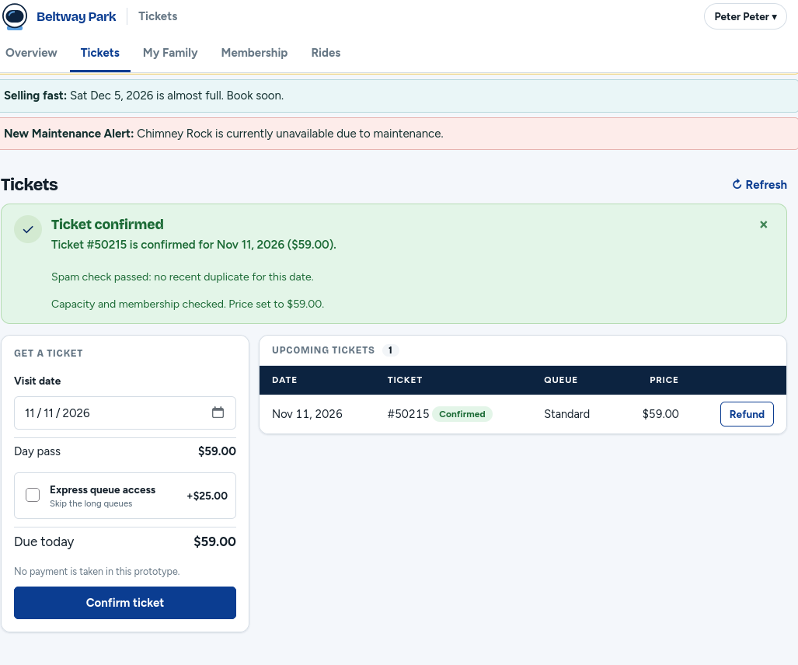

# Beltway Park 

A theme park management web app. Guests buy tickets and memberships and use a member portal. Staff run rides, maintenance, shifts, sales and reports. Admins manage logins and records.

**Stack:** React 19, Vite, React Router, Recharts · Node.js (no Express) · MySQL 8.4 in Docker

**Requirements:** Node 20.12+, npm, Docker with Compose

## Quick start

1. Create the environment files and set the same `DB_PASSWORD` in the root and `server` ones:
   ```bash
   cp .env.example .env
   cp server/.env.example server/.env
   ```
   In `client/.env`, set `VITE_USE_MOCK=false` so the app uses the database.
2. Install dependencies:
   ```bash
   (cd server && npm install) && (cd client && npm install)
   ```
3. Start the database (the first run loads the schema):
   ```bash
   docker compose up -d --wait mysql
   ```
4. Load the demo data and create staff logins. Passwords print once, so save them:
   ```bash
   cd server && npm run seed
   ```
5. Run the backend and the frontend in two terminals:
   ```bash
   cd server && node --watch index.js
   cd client && npm run dev
   ```
6. Open the URL Vite prints (usually http://localhost:5173). Staff sign in at `/staff/login`.

## Project layout

- `client/` React app
- `server/` Node API
- `SQL/` database schema, rules and data
- `docs/` images

## Features

- **Weather closure:** an Admin can close and reopen the park in one click. While closed, the database blocks ride boardings and sales.
- **Ride notices:** adding or deactivating a ride posts a notice on the homepage for 7 days.
- **Editing from reports:** Admins and managers can edit, delete or add records directly from a report's detail rows. The report updates right away.

Existing databases need the matching SQL rule applied for the first two features. See `SQL/`.

## Screenshots

### Homepage


### Admin portal


### Member portal

